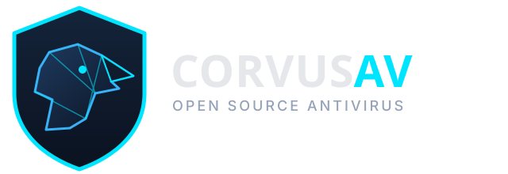
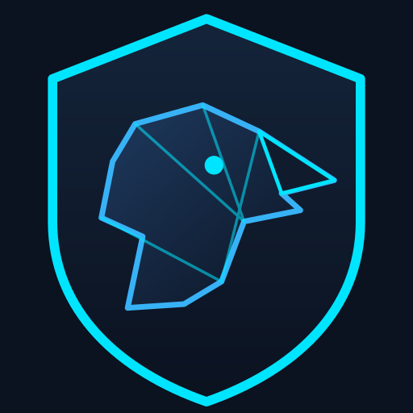
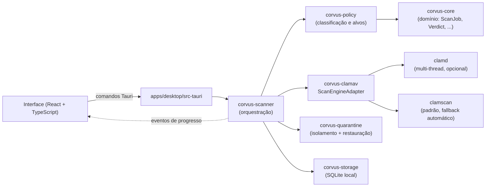

<p align="center">
  
</p>

<p align="center">
  <strong>Antivírus gratuito, open source, modular e nativo para Windows 10/11.</strong><br />
  Rust no núcleo. Tauri 2 + React na interface. ClamAV na detecção. Zero telemetria por padrão.
</p>

<p align="center">
  
  
  
  <br />
  
  
  
  
  
  
</p>

<p align="center">
  <a href="#-o-que-esta-versão-010-realmente-faz">Funcionalidades</a> ·
  <a href="#-arquitetura">Arquitetura</a> ·
  <a href="#-como-executar">Como executar</a> ·
  <a href="#️-status-de-validação-desta-entrega">Status de validação</a> ·
  <a href="#-roadmap">Roadmap</a> ·
  <a href="#-documentação">Documentação</a>
</p>

---

> **⚠️ Aviso de marca:** o nome e o logotipo "CorvusAV" são **provisórios**, até a conclusão de uma análise formal de disponibilidade jurídica (INPI e demais mercados-alvo).
>
> **⚠️ Aviso de segurança:** o CorvusAV **não substitui** o Microsoft Defender nem qualquer antivírus comercial. Esta é a primeira versão (`0.1.0`), em desenvolvimento ativo, sem proteção contínua e sem garantia de cobertura completa. Veja as limitações em [`docs/roadmap/README.md`](docs/roadmap/README.md) e [`docs/security/README.md`](docs/security/README.md).

## Sobre o projeto

O CorvusAV nasce com um objetivo simples: um antivírus para Windows que qualquer pessoa possa inspecionar, compilar e confiar — sem telemetria oculta, sem licença paga e sem caixa-preta. A engenharia segue princípios de segurança por padrão, privilégio mínimo e separação clara de responsabilidades: um núcleo em Rust sem dependências de interface, adaptadores isolados para motores de detecção (começando pelo ClamAV), persistência local em SQLite, e uma interface desktop em Tauri 2 que nunca roda como administrador.

Este repositório documenta honestamente o que **já funciona** e o que **ainda não existe** — nenhuma funcionalidade simulada é apresentada como pronta.

## ✅ O que esta versão (0.1.0) realmente faz

| Área | Status |
| --- | --- |
| Interface desktop (Tauri 2 + React + TypeScript + Tailwind) com a **Central de Verificação** | ✅ Implementado |
| Verificação **rápida** (Downloads, Área de Trabalho, Documentos, pasta temporária) via ClamAV | ✅ Implementado |
| Verificação **personalizada** (seleção de pastas via diálogo nativo) | ✅ Implementado |
| Progresso em tempo real e cancelamento cooperativo de uma verificação em andamento | ✅ Implementado |
| Histórico de verificações persistido em SQLite local | ✅ Implementado |
| **Quarentena** segura (isolamento com ACLs restritas, auditoria, restauração) | ✅ Implementado |
| Mecanismo de verificação dual: `clamscan` como padrão, com `clamd` (daemon) opcional para varredura multi-thread em pastas grandes, com fallback automático | 🧪 Implementado — compila, comportamento real em produção ainda não validado |
| Detecção e exclusão de arquivos "só na nuvem" (OneDrive / Arquivos sob Demanda) durante a verificação, para não travar a varredura forçando downloads | 🧪 Implementado — ainda não compilado/testado em ambiente real |
| Identidade visual própria (paleta, tipografia, logotipo vetorial original) | ✅ Implementado |
| Verificação **completa** (todas as unidades) | 🚧 Indisponível no v0.1.0 — UI informa isso explicitamente |
| Monitoramento em tempo real, YARA-X, heurística, Machine Learning | 📋 Planejado (ver [Roadmap](#-roadmap)) |
| Serviço Windows privilegiado, IPC via named pipes, driver de kernel | 📋 Planejado (fases futuras) |

> 🧪 = implementado nesta base de código, mas ainda sem validação completa de funcionamento real (compilação e/ou testes manuais pendentes). Nunca tratado como "pronto" até ser confirmado.

## 🦅 Identidade visual

<p align="center">
  
</p>

Logotipo vetorial e ícone originais, desenhados para o projeto (paleta escura, tipografia Exo 2/Inter). Os arquivos-fonte ficam em [`assets/branding/`](assets/branding/) — SVG do logotipo e da marca, e os ícones gerados para o instalador/aplicativo Windows. Nome e logotipo são provisórios, como já avisado no topo deste documento.

## 🏗️ Arquitetura

Monorepo + monólito modular: um núcleo de domínio sem dependências de infraestrutura, adaptadores isolados por responsabilidade, e uma interface que nunca acessa dados sensíveis diretamente.



Nenhum arquivo examinado é executado para avaliação. Os processos do ClamAV são invocados isolados, sem shell, com argumentos explícitos — nunca por interpolação de string. O `ScanEngineAdapter` tenta `clamd` (quando disponível no sistema) para aproveitar múltiplas threads sobre a mesma base de assinaturas já carregada, e cai para `clamscan` automaticamente sempre que `clamd` não estiver disponível ou não responder a tempo — uma falha depois que o `clamd` já estava rodando nunca é mascarada por esse fallback.

## 🧱 Stack tecnológica

- **Núcleo e serviços:** Rust (workspace Cargo com 7 crates: `corvus-core`, `corvus-storage`, `corvus-clamav`, `corvus-policy`, `corvus-scanner`, `corvus-quarantine`, além do backend Tauri)
- **Interface desktop:** Tauri 2 · React 18 · TypeScript (strict) · Vite · Tailwind CSS · Zustand
- **Persistência:** SQLite (`rusqlite`, migrations versionadas) — verificações, resultados, detecções e itens de quarentena
- **Concorrência/E-S assíncrona:** `tokio` (processos externos, timeouts, cancelamento cooperativo, cliente TCP para o protocolo do `clamd`)
- **Detecção:** ClamAV — `clamscan` (processo externo, padrão) e `clamd` (daemon local, opcional, multi-thread, com fallback automático para `clamscan`) — YARA-X e ML são fases futuras
- **Quarentena:** isolamento de arquivos com ACLs restritas, nomes internos aleatórios (`uuid`), auditoria e restauração autenticada
- **Tipografia:** Exo 2 (títulos) + Inter (texto), 100% local via `@fontsource`

## 🚀 Como executar

Pré-requisitos completos em [`docs/development/README.md`](docs/development/README.md). Resumo: Windows 10/11 x64, Rust + Cargo, Node.js 18+, e o ClamAV para Windows instalado (`clamscan.exe` no `PATH`, ou configurável via `CORVUSAV_CLAMAV_PATH`).

```powershell
cd C:\dev\CorvusAV\apps\desktop
npm install
npm run tauri dev
```

## 📦 Como compilar o executável/instalador

```powershell
cd C:\dev\CorvusAV\apps\desktop
npm run tauri build
```

## 🧪 Testes

```powershell
# Workspace Rust (raiz do repositório)
cargo fmt --all -- --check
cargo clippy --workspace --all-targets -- -D warnings
cargo test --workspace

# Frontend (apps/desktop)
npm run build
npm run test
```

## ⚠️ Status de validação desta entrega

Este projeto é desenvolvido com o apoio do Claude, que não tem acesso a um ambiente Windows real nem a um toolchain Rust/Node — por isso todo o código é escrito e revisado manualmente (incluindo scripts próprios de verificação de sintaxe), mas só é **compilado e testado de fato** quando o mantenedor roda os comandos no Windows. Este README reflete honestamente essa distinção:

- **Frontend**: compilado (`npm run build`) e testado (`npm run test`) com sucesso.
- **Backend Rust (workspace Cargo + Tauri)**: compilado com sucesso pelo mantenedor em ambiente Windows real, incluindo a Central de Verificação, o histórico e a quarentena.
- **Mecanismo dual `clamscan`/`clamd`** (seção acima): compila, mas ainda **não há confirmação** de que `clamd` é de fato detectado/usado numa verificação real, nem de que o ganho de desempenho esperado se confirma na prática.
- **Exclusão de arquivos "só na nuvem" do OneDrive**: implementada nesta sessão, **ainda não compilada nem testada** pelo mantenedor.

Sempre que uma funcionalidade aparecer como 🧪 na tabela acima, significa que o código existe e foi revisado, mas seu funcionamento real ainda não foi confirmado — nunca tratamos isso como "pronto".

Capturas de tela reais da interface em execução serão adicionadas aqui assim que o fluxo completo (incluindo as funcionalidades experimentais) for validado em uso real.

## 📁 Estrutura do projeto

```text
C:\dev\CorvusAV\
├── apps\desktop\          # App Tauri 2 (React/TS/Tailwind + backend Rust do app)
├── crates\
│   ├── corvus-core\       # Domínio: tipos, estados, erros
│   ├── corvus-storage\    # Persistência SQLite
│   ├── corvus-clamav\     # Adaptadores ClamAV (clamscan + clamd) e seleção de motor
│   ├── corvus-policy\     # Regras de decisão e políticas de alvo
│   ├── corvus-scanner\    # Orquestração das verificações
│   └── corvus-quarantine\ # Isolamento, auditoria e restauração de itens em quarentena
├── assets\branding\       # Identidade visual (logo, ícones, paleta)
├── docs\                  # Arquitetura, segurança, desenvolvimento, roadmap
└── .github\workflows\     # CI (GitHub Actions)
```

## 🗺️ Roadmap

Fases detalhadas e critérios de aceite em [`docs/roadmap/README.md`](docs/roadmap/README.md).

| Fase | Foco |
| --- | --- |
| 0 — concluída | Fundação: monorepo, Central de Verificação, verificação rápida/personalizada via ClamAV |
| 2 — adiantada | Quarentena segura e restauração auditável — ✅ implementada (compilada; validação completa em VM ainda pendente) |
| 1 | Verificação completa, agendamento, relatórios |
| 3 | Serviço Windows privilegiado, IPC via named pipes |
| 4 | Monitoramento de arquivos em tempo real |
| 5 | YARA-X e heurísticas |
| 6+ | Machine Learning experimental, drivers (avaliação futura) |

> A quarentena (fase 2) foi adiantada e já está implementada; além disso, duas melhorias de desempenho fora do roadmap original já estão no código (experimentais, ver tabela de funcionalidades acima): um motor `clamd` opcional multi-thread e a detecção de arquivos "só na nuvem" do OneDrive durante a verificação.

## 📚 Documentação

- [`docs/architecture/`](docs/architecture/) — decisões de arquitetura (ADRs)
- [`docs/security/`](docs/security/) — modelo de ameaças
- [`docs/development/`](docs/development/) — ambiente, comandos, e o que foi/não foi validado
- [`docs/roadmap/`](docs/roadmap/) — fases futuras e critérios de conclusão
- [`SECURITY.md`](SECURITY.md) — como reportar vulnerabilidades
- [`CONTRIBUTING.md`](CONTRIBUTING.md) — como contribuir
- [`CHANGELOG.md`](CHANGELOG.md) — histórico de versões

## 🤝 Contribuindo

Contribuições são bem-vindas. Veja [`CONTRIBUTING.md`](CONTRIBUTING.md) para o checklist de qualidade (fmt, clippy, testes) antes de abrir um pull request — e, para qualquer parte marcada como 🧪 experimental neste README, inclua o que você validou (ou não) ao testar.

## 🔒 Segurança

Para reportar uma vulnerabilidade, siga o processo em [`SECURITY.md`](SECURITY.md). Não abra uma issue pública para falhas de segurança sensíveis.

## 📄 Licenciamento

A estratégia de licenciamento ainda **não foi definida**: é necessário revisar a compatibilidade entre a licença final do projeto, a GPLv2 do ClamAV (`clamscan` e `clamd`), e as licenças do Tauri, YARA-X (fase futura) e demais dependências, conforme o modo concreto de integração e redistribuição — invocar o ClamAV como processo externo separado não é, por si só, garantia de ausência de obrigações de licença. **Não distribua builds públicos deste projeto até essa definição.**

---

<p align="center">
  <sub>Feito com 🦀 Rust e 🐦‍⬛ um pouco de paranoia saudável sobre segurança.</sub>
</p>
